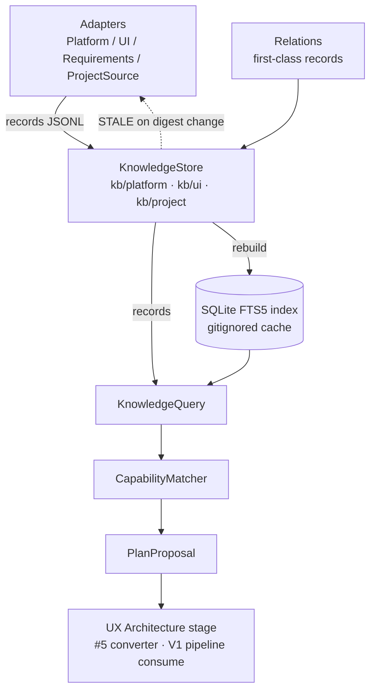

# Knowledge Foundation — Architecture

> **Status:** DRAFT for review (issue [#7](https://github.com/thanhle74/design-engineering-toolkit/issues/7)). Companion documents: [CONTRACTS.md](CONTRACTS.md) (the nine contracts — normative), [resources/schemas/](../../../resources/schemas/README.md) (example record shapes), [TECH-ADR.md](TECH-ADR.md) (technology), [IMPLEMENTATION-PLAN.md](IMPLEMENTATION-PLAN.md) (how this gets built).
>
> **Specification only.** No engine, store, or adapter exists yet; this document describes the architecture a future GO would implement.

## 1. Where this sits

The canonical roadmap (normative, from [README.md](README.md)):

```
Requirements → Platform/UI Audit → Capability Registry → UX Architecture
→ Figma Design → Structural Mapping → Functional Round-trip → Visual Fidelity
```

- The **V1 pipeline** ([docs/ARCHITECTURE.md](../../ARCHITECTURE.md), issue #1/#2) already covers *Figma Design* through *Visual QA* as contracts + a manual pilot.
- **Issue #5** (running, untouched) specifies the *Capability Registry → Structural Mapping → Functional Round-trip → Visual Fidelity* converter path; its open research PR #6 defines `NodeIR`, `CapabilityRegistry`, `ResolutionReport`, and the converter stage ladder.
- **This foundation** supplies everything to the **left** of that: Requirements, Platform/UI Audit inputs, and the Capability Registry as a *shared, evidence-backed knowledge layer* — plus the evidence model all stages consume.

Boundary rule: this architecture defines knowledge **inputs and contracts**. It does not define the Figma composition engine, the Page Builder converter, or any CMS interaction — those remain #5/V1 concerns and later gated stages.

## 2. The three domains and their boundaries

| | **KB-1 — Platform Knowledge** | **KB-2 — UI Component Knowledge** | **KB-3 — Project Knowledge** |
|---|---|---|---|
| Question | WHAT THE SYSTEM CAN DO | WHAT CAN BE COMPOSED | WHAT THIS CLIENT NEEDS & APPROVED |
| Owns | `Capability`, `DataProvider` records: render capabilities, catalog features, integrations, config constraints, with enablement/proof facts | `UIComponent` records from **three distinct sources** (Hyvä UI upstream · `Secomm_UiWidget` imported · Page Builder native) + their UX-semantic mapping + availability states | `Requirement`, `UXIntent`, `Composition`, `Decision`, `Approval`, `Risk`, `OpenQuestion`, `Constraint`, `SourceDocument` records |
| Scope | Shared infrastructure (one store per audited platform+version, reusable across projects) | Shared infrastructure per UI source+version; **usage links** are per-project | Strictly per-project (tenant-partitioned) |
| Cardinality (audited checkout, measured) | hundreds (528 modules tracked; 20 PB content types / 33 appearances; 41 Secomm modules) | ~70 Hyvä UI variants · 21 imported widgets · 20 native types — linked, **not summed** | ~50–60 records for the pilot project alone (see [SOURCE-INVENTORY.md](SOURCE-INVENTORY.md) §sufficiency) |
| Non-negotiable | Installed ≠ enabled ≠ configured ≠ runtime verified; Magento introspection lives in an adapter | Licensed Hyvä UI = metadata + pointers only, by schema structure; equivalence is a *link* (`mapsTo`/`equivalentOf` only within a capability/editability class; `neighborOf` across developer-owned vs Page Builder native), never a duplicate record | Cross-project isolation; sanitized/synthetic in the public repo; external IDs (LC/FC/LA) never canonical |
| Key risk the design answers | A KB that parsed only declarations would undercount (widget.xml declares 1 widget; the 21 components live in the di.xml registry) | Counting the same banner three times (upstream + widget + PB) — solved by relation edges, not merging | ID collision between business (BA) and engineering taxonomies — solved by namespaced `externalRef` + `traceStatus` |

**What belongs nowhere:** runtime secrets, file contents in bulk, licensed vendor source/assets, cross-project links, invented components (`GAP`/`CUSTOM_REQUIRED`/`UNKNOWN` are the only honest outputs for missing capabilities).

## 3. System architecture

```
┌────────────────────────── Project context (per-project, local) ──────────────────────────┐
│  profiles (public) · local ignored config (rootAliases, never committed)                  │
└──────────────┬───────────────────────────────────────────────────────────────────────────┘
               │ bind(roots, denyGlobs)
┌──────────────▼───────────────────── ADAPTERS (out-of-process, optional) ─────────────────┐
│ ProjectSourceAdapter   PlatformCapabilityAdapter   UIInventoryAdapter   Requirements…    │
│ (path gateway: allowlist + deny-globs + realpath; DENIED_PATH_SKIPPED diagnostics)       │
└──────────────┬───────────────────────────────────────────────────────────────────────────┘
               │ records (JSONL) + diagnostics
┌──────────────▼────────────────────── PORTS (language-neutral) ───────────────────────────┐
│ KnowledgeStore  (write-time validation, digest pinning, no deletes — lifecycle only)     │
│ KnowledgeQuery  (structured deterministic filters; provenance on every hit)              │
│ CapabilityMatcher (need → candidates via edges; gaps as GAP/CUSTOM_REQUIRED/UNKNOWN)     │
│ PlanProposal    (requirement+profiles → ranked section plan; never a Figma design)       │
└──────────────┬───────────────────────────────────────────────────────────────────────────┘
               │
┌──────────────▼────────────────────── STORE (git-versioned) ──────────────────────────────┐
│ kb/platform/   kb/ui/   kb/project/        ← three LOGICAL domains, one physical format   │
│ (JSONL records, one per line)              + relations as first-class records            │
│ derived, gitignored: SQLite index (FTS5)  ← a cache; rebuildable, never truth             │
└──────────────────────────────────────────────────────────────────────────────────────────┘
               │
      Consumers: #5 converter (CapabilityRegistry seed) · V1 Figma pipeline (S2/S3 evidence)
      · UX Architecture stage (PlanProposal) · humans reviewing evidence chains
```

The same diagram as dependency rules (normative):



Rules the diagram encodes:

1. **Adapters are the only code that touches user sources.** Everything else sees records.
2. **The index is disposable.** Deleting it loses nothing; the manifests are truth (TECH-ADR §storage).
3. **Knowledge flows one way**: sources → records → queries → plans. No stage writes back to sources; no plan writes a design.
4. **The store is append-immutable**: corrections are new versions + `supersedes`; states are `STALE`/`INVALIDATED`/`ARCHIVED` — never deletions (V1 invariant "deletes are unrepresentable", extended to knowledge).

## 4. Ingestion architecture

### 4.1 Ingestion plans

Every scan is defined by a plan: `{sourceId, adapterKind, allowRoots[] (rootAliases), denyGlobs[], parserProfile, schedule}`. Plans are data (profile/local-config), reviewable, and diffable. Scanning outside a plan is a contract violation. **No blind embeddings of whole codebases** — ingestion depth is tiered ([CONTRACTS.md §4.2](CONTRACTS.md)): T0 declarations/manifests (default), T1 targeted reads, T2 LLM-assisted classification (propose-only, capped at `ASSUMED` until human-verified).

### 4.2 Adapter inventory (first wave)

| Adapter | Emits into | Sources (audited checkout evidence) |
|---|---|---|
| `adapter-magento` | KB-1 | Per-version content-type declarations (20 files, per-file layout — **not** a single `etc/content_type.xml`; discovery must be version-aware), widget + DI component registries (`widget.xml` declares 1 widget; di.xml injects the 21 component definitions — both layers required), enablement map (`config.php`: 524/528 enabled), lockfile versions, module topology (`module.xml` sequence) |
| `adapter-hyva-ui` | KB-2 | Metadata-only inventory of the licensed package: 36 components / 70 variants, plugin scaffold, license facts — identifiers, counts, path pointers, **never contents** |
| `adapter-uiwidget` | KB-2 | The 21 imported component records with `adaptedFrom` edges (registry carries `source_component` + `source_version` — the mapping already exists as prose; this formalizes it) + eligibility dispositions (B1/B2/DEFER/EXCLUDE) |
| `adapter-pagebuilder-native` | KB-2 | 20 native content types as `available-upstream` + `editable-in-page-builder` records; `neighborOf` edges to widget/Hyvä counterparts |
| `adapter-requirements` | KB-3 | Specs, tickets, approved notes → the nine record types; Figma-derived material only via already-audited manifests (no new Figma reads) |

### 4.3 The path gateway (structural enforcement)

One module, one code path to the filesystem: allowlist roots resolved via `realpath` (symlinks cannot escape), deny-globs applied **before** any read (`auth.json`, `app/etc/env.php`, `.env*`, credentials, `var/`, `generated/`, bulk media, licensed package artifacts beyond inventory metadata), denials recorded as `DENIED_PATH_SKIPPED` diagnostics. Proven by **negative fixture tests** (planted fake `auth.json` must appear in diagnostics, never in output) — the same fail-closed pattern as V1's `UNKNOWN`-blocks-S4.

### 4.4 Incremental sync

Records pin `observed.inputDigests` (path → sha256). Re-scan compares digests: unchanged → skip; changed → dependents marked `STALE` and a re-audit job queued; no record is silently re-derived. Worked example (measured digests from the audited checkout): lockfile → platform/version facts; `config.php` → enablement facts; widget/di registry files → component registry; content-type directory → PB capabilities; `module.xml` files → dependency topology ([SOURCE-INVENTORY.md](SOURCE-INVENTORY.md) §re-audit-triggers).

## 5. Query architecture

- **Structured deterministic filters first** ([CONTRACTS.md §5](CONTRACTS.md)): kb, projectId/tenantId, platform+version, category/origin, variant, proofLevel, reviewStatus, licenseStatus, edgeType/relatedTo. Identical query ⇒ identical result order.
- **Provenance on every hit**: results are schema'd envelopes carrying evidence; a query layer that cannot fill provenance cannot return the record.
- **The index is a cache**: FTS5 over titles/semantics behind the same `KnowledgeQuery` port; rebuild = deterministic command; vector/embedding retrieval is out until a measured >30% structured-miss rate over a full milestone (TECH-ADR §storage thresholds).
- **Honest filtering**: proof-level and license-status filters are exact; no "probably fine" downgrades.

## 6. Knowledge lifecycle (record state machine)

```
        scan (digests pinned)
  ┌──────────────────────────────┐
  ▼                              │
ACTIVE ──digest changed──► STALE ──re-verified──► ACTIVE
   │                                                   │
   ├─proven wrong──► INVALIDATED (retained, excluded)  │
   ├─replaced──────► ARCHIVED (supersedes pointer)     │
   └───────────────────────────────────────────────────┘
```

- **Review gates**: `unreviewed → reviewed → approved`; business-critical and T2-classified records must be reviewed before they may back decisions.
- **Conflicts**: disagreeing scans keep both observations + `CONFLICTING_OBSERVATIONS` diagnostic; a stronger proof level or human resolves — never silent last-write-wins.
- **History & rollback**: the store is git-versioned; old-version lookup keys off `observed.scannedAt`; rollback = revert. (TECH-ADR §storage.)

## 7. Cross-project protections

1. **Partitioning**: KB-3 records and edges carry `projectId`+`tenantId`; the store partitions by project; cross-partition edges are write-time errors; unscoped queries are errors (default-deny).
2. **Sanitization ladder**: `private` (tenant-only) → `sanitized` (client tokens stripped) → `example` (synthetic, public-repo eligible). Real client material (specs, approvals, names, fileKeys policy pending — see open decisions) never leaves `private` without a recorded sanitization pass. The public toolkit carries **synthetic examples only**.
3. **Licensing separation**: licensed-package knowledge has metadata-only schema fields, but arbitrary strings could still carry snippets or secrets: validate, limit and sanitize every free-text value at ingestion and at export; add negative fixture tests for copyrighted source/keys. Derived artifacts cite provenance pointers; local auditing requires authorized access.
4. **External-ID hygiene**: business taxonomy IDs (LC/FC/LA/Jira) are `externalRef` with `traceStatus` — the audit found the same token naming two different taxonomies, so collision is treated as live risk, not hypothetical.

## 8. Deployment & packaging shape

One repository, language/runtime per [TECH-ADR.md](TECH-ADR.md) (TypeScript/Node core, JSON Schema 2020-12 canonical): `core` (CLI + ports + validation + store/index), optional out-of-process `adapters/*`, profiles as data. Per-project roots via CLI flag → env → local git-ignored config. Core runs with **zero** Magento, Hyvä, or Figma installed — proven by a synthetic second project in CI (IMPLEMENTATION-PLAN M3). Source-root examples in all shared artifacts use placeholders; the owner's real paths appear only in evidence receipts as resolved pointers.

## 9. Dependency map (document level)

| This document depends on | Fed by |
|---|---|
| [CONTRACTS.md](CONTRACTS.md) | issue #7 requirements; W-A/W-B/W-C receipts |
| [resources/schemas/](../../../resources/schemas/README.md) | CONTRACTS.md; V1 schema family |
| [SOURCE-INVENTORY.md](SOURCE-INVENTORY.md) | W-A (platform), W-B (UI/licensing), W-C (project materials), W-D (repo/stack facts) |
| [TECH-ADR.md](TECH-ADR.md) | W-D ADR recommendation; PR #6 alignment; repo state |
| [UX-CAPABILITY-PLANNING.md](UX-CAPABILITY-PLANNING.md) | CONTRACTS §7; synthetic walkthrough |
| [IMPLEMENTATION-PLAN.md](IMPLEMENTATION-PLAN.md) | all of the above |

## 10. Open decisions carried forward

See [TECH-ADR.md](TECH-ADR.md) §OPEN-DECISIONS and [INTEGRATION-RECEIPT.md](INTEGRATION-RECEIPT.md). The load-bearing ones: SQLite driver choice (P1 spike), semantic retrieval gate (needs query-log evidence), BA registry anchoring for KB-3 (Owner-supplied checklist), storage venue for tenant-private KB-3 material (in-repo sanitized vs private store), first-party fileKey publication policy.
